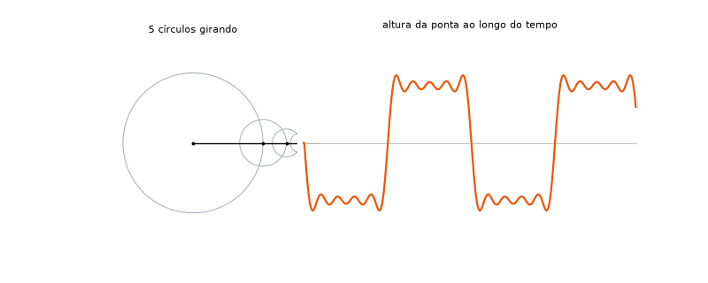
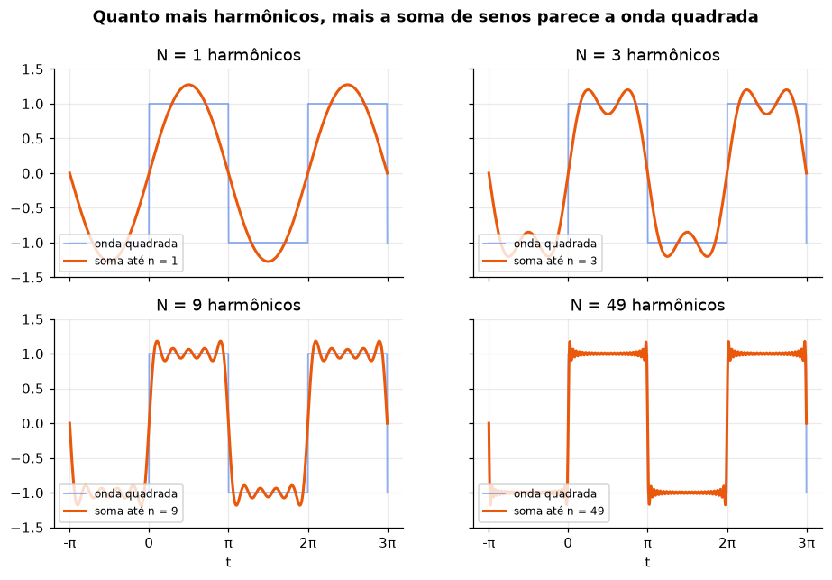
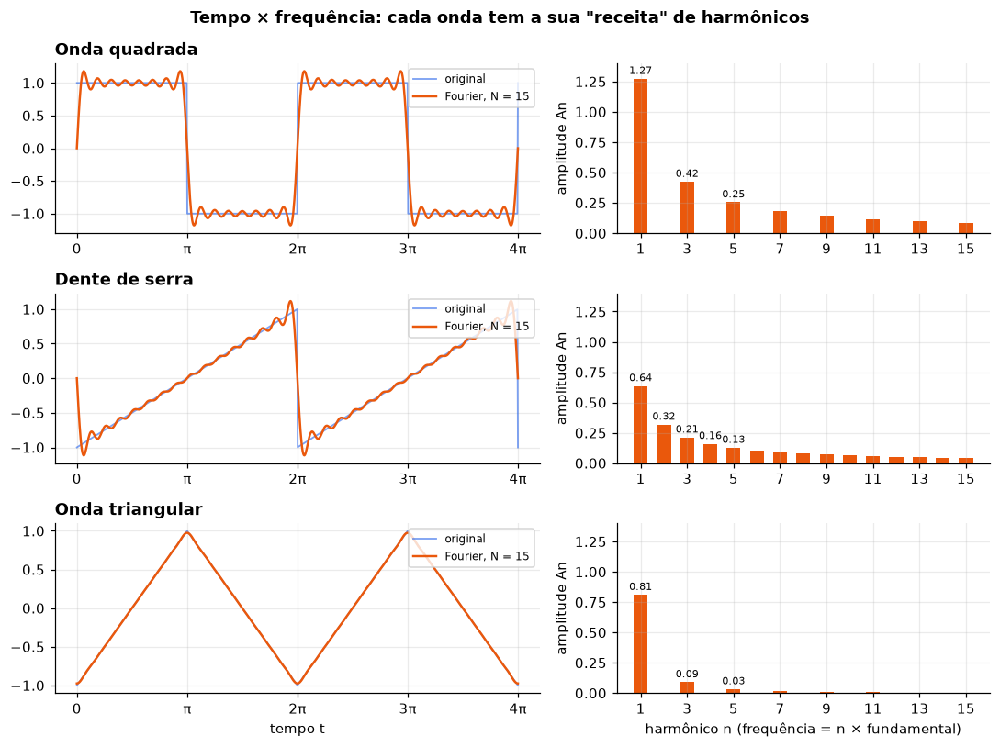
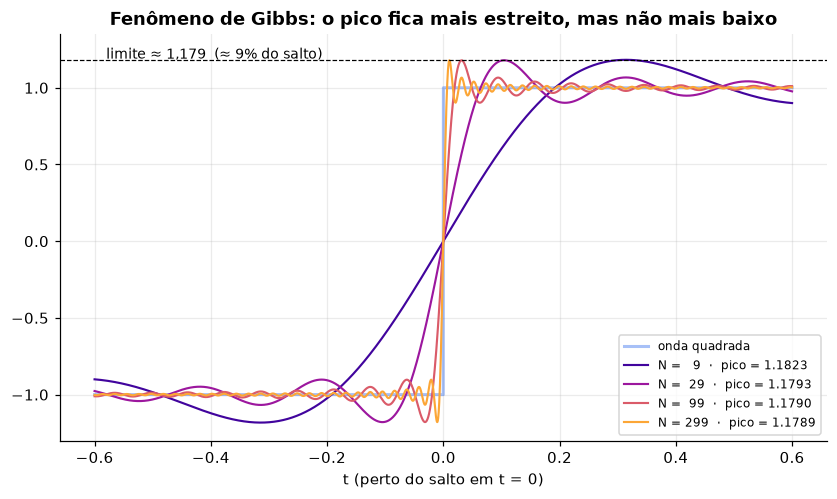
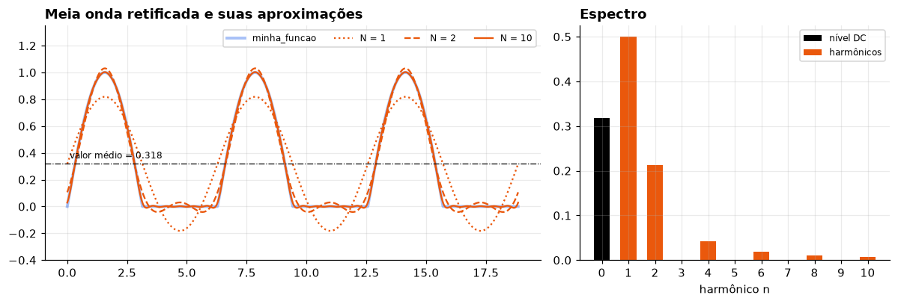

# Série de Fourier, desenhada e explicada

<p align="center">
  
</p>

Qualquer sinal periódico (som, vibração, tensão de uma fonte, batimento cardíaco) pode ser montado **somando senos e cossenos**. Este repositório mostra isso na prática, em Python, com gráficos e código comentado linha a linha.

> Não precisa saber cálculo para acompanhar os gráficos. As fórmulas estão aqui para quem quiser ligar a teoria ao código.

---

## Sumário
1. [A ideia em uma frase](#1-a-ideia-em-uma-frase)
2. [A fórmula, peça por peça](#2-a-fórmula-peça-por-peça)
3. [Do papel para o código](#3-do-papel-para-o-código)
4. [Os exemplos](#4-os-exemplos)
5. [Como rodar](#5-como-rodar)
6. [Para ir além](#6-para-ir-além)

---

## 1. A ideia em uma frase

> **Uma onda complicada é uma soma de ondas simples, cada uma com sua frequência, seu tamanho e seu atraso.**

É o que o ouvido faz o tempo todo: um acorde de violão chega como uma única vibração do ar, e mesmo assim você percebe as notas separadas. A série de Fourier é a matemática de "separar as notas".

---

## 2. A fórmula, peça por peça

Uma função $f(t)$ que se repete a cada $T$ segundos pode ser escrita como:

$$
f(t) \approx \frac{a_0}{2} + \sum_{n=1}^{N} \Big[ a_n \cos(n\,\omega_0\,t) + b_n \sin(n\,\omega_0\,t) \Big]
\qquad \text{com} \qquad \omega_0 = \frac{2\pi}{T}
$$

| Símbolo | Nome | O que significa |
|---|---|---|
| $T$ | período | de quanto em quanto tempo a onda se repete |
| $\omega_0 = 2\pi/T$ | frequência fundamental | a "nota principal" da onda |
| $n$ | número do harmônico | o harmônico $n$ vibra $n$ vezes mais rápido que a fundamental |
| $a_0/2$ | nível DC | o **valor médio** da onda (onde ela "fica no meio") |
| $a_n$ | coeficiente de cosseno | quanto do cosseno de frequência $n$ existe na onda |
| $b_n$ | coeficiente de seno | quanto do seno de frequência $n$ existe na onda |
| $N$ | quantidade de termos | com $N$ pequeno temos um esboço; com $N$ grande, os detalhes |

### De onde vêm $a_n$ e $b_n$?

$$
a_n = \frac{2}{T}\int_0^T f(t)\cos(n\,\omega_0\,t)\,dt
\qquad\qquad
b_n = \frac{2}{T}\int_0^T f(t)\sin(n\,\omega_0\,t)\,dt
$$

**Intuição:** multiplicar $f(t)$ por um seno de frequência $n$ e calcular a média funciona como um **filtro**.
- Se $f$ tem um pedaço que vibra junto com esse seno, os dois sobem e descem juntos. O produto fica quase sempre positivo, e a média dá um número grande.
- Se não tem, o produto fica ora positivo, ora negativo, e a média dá **zero**.

Isso funciona porque senos e cossenos de frequências diferentes são **ortogonais**: a integral do produto deles num período é zero. É a mesma ideia de achar as coordenadas $x$ e $y$ de um vetor projetando-o nos eixos. Aqui os "eixos" são as senoides.

### Amplitude e fase

Cada par $(a_n, b_n)$ é, na verdade, **uma única senoide** deslocada:

$$
a_n\cos(x) + b_n\sin(x) = A_n \cos(x - \varphi_n),
\qquad A_n = \sqrt{a_n^2 + b_n^2},
\qquad \varphi_n = \operatorname{atan2}(b_n, a_n)
$$

- $A_n$ (**amplitude**): o tamanho daquele harmônico. O gráfico de $A_n$ por $n$ é o **espectro**.
- $\varphi_n$ (**fase**): o quanto aquele harmônico está atrasado.

Na animação do topo, cada **círculo** é um harmônico: o raio é $A_n$, a velocidade de giro é $n$ e o ângulo inicial é a fase.

---

## 3. Do papel para o código

Tudo está em [`fourier.py`](fourier.py), que tem pouco mais de 100 linhas, quase metade comentários.

### O computador não sabe integrar: ele soma fatias

Uma integral é a área sob a curva. O computador divide o período em milhares de fatias finas e soma a área de cada uma (soma de Riemann, pela regra do ponto médio):

```python
dt = T / amostras                       # largura de cada fatia
t = (np.arange(amostras) + 0.5) * dt    # o meio de cada fatia
y = f(t)                                # altura da função ali

a0 = (2 / T) * np.sum(y) * dt           # ∫ f(t) dt  ≈  Σ altura × largura
```

### Todos os coeficientes de uma vez

Em vez de um `for` para cada $n$, o código monta uma **matriz** em que cada linha é um cosseno de frequência diferente. O numpy calcula tudo de uma vez:

```python
n = np.arange(1, N + 1)[:, None]        # coluna [1, 2, ..., N]
cos_n = np.cos(n * w0 * t)              # N linhas × amostras colunas
a = (2 / T) * np.sum(y * cos_n, axis=1) * dt   # uma integral por linha
```

O `[:, None]` transforma `n` numa coluna. Multiplicar uma coluna por uma linha (`t`) gera a matriz inteira, um recurso do numpy chamado *broadcasting*.

### Remontando a onda

```python
s = a0 / 2                                         # começa pelo valor médio
for k in range(1, N + 1):                          # soma harmônico por harmônico
    s += a[k-1] * np.cos(k * w0 * t) + b[k-1] * np.sin(k * w0 * t)
```

### O código confere com a teoria?

Para a onda quadrada, a teoria diz que $b_n = \frac{4}{n\pi}$ para $n$ ímpar e $0$ para $n$ par. Rode `py fourier.py`:

```
n   an (~0)      bn calculado   bn teórico
1   +0.00000    +1.27324       +1.27324
2   +0.00000    +0.00000       +0.00000
3   +0.00000    +0.42441       +0.42441
5   +0.00000    +0.25465       +0.25465
```

### Mapa do código

| No código | Na matemática | Onde |
|---|---|---|
| `T` | $T$, o período | todos os exemplos |
| `w0 = 2 * np.pi / T` | $\omega_0$ | `coeficientes`, `soma_parcial` |
| `a0, a, b = coeficientes(f, T, N)` | $a_0$, $a_n$, $b_n$ | `fourier.py` |
| `soma_parcial(t, T, a0, a, b, N)` | $S_N(t)$, a soma até $N$ | `fourier.py` |
| `amplitude_fase(a, b)` | $A_n$ e $\varphi_n$ | `fourier.py` |
| `np.sum(...) * dt` | $\int \dots\,dt$ | `coeficientes` |

---

## 4. Os exemplos

### 01 · Montando uma onda quadrada só com senos
[`exemplos/01_onda_quadrada.py`](exemplos/01_onda_quadrada.py)

Com 1 termo temos uma senoide. Com 3, aparecem "ombros". Com 49, a onda já parece quadrada. Cada termo novo acrescenta um detalhe mais fino, de frequência mais alta.



### 02 · O espectro: a "receita" de cada onda
[`exemplos/02_espectro.py`](exemplos/02_espectro.py)

À esquerda, a onda **no tempo**. À direita, **na frequência**: quanto de cada harmônico ela tem.



| Onda | Harmônicos | Caem como | Por quê |
|---|---|---|---|
| Quadrada | só ímpares | $1/n$ | tem **saltos** → precisa de muitas frequências altas |
| Dente de serra | todos | $1/n$ | também tem um salto por período |
| Triangular | só ímpares | $1/n^2$ | **sem saltos**, só quinas → com poucos termos já fica ótima |

**Regra prática:** quanto mais "abrupta" a onda, mais devagar o espectro cai. É por isso que a onda triangular de N = 15 está praticamente perfeita, e a quadrada ainda ondula.

### 03 · O fenômeno de Gibbs
[`exemplos/03_gibbs.py`](exemplos/03_gibbs.py)

Perto de um salto, a soma sempre **passa do ponto**. Com mais termos o "chifre" fica mais estreito, mas **não mais baixo**: ele para em ≈ 9% do tamanho do salto.



| N | Pico | Passou do salto |
|---|---|---|
| 9 | 1,1823 | 9,12% |
| 29 | 1,1793 | 8,97% |
| 99 | 1,1790 | 8,95% |
| 299 | 1,1789 | 8,95% |

O mesmo efeito aparece como "halos" em volta de bordas em imagens JPEG muito comprimidas e como *ringing* em áudio.

### 04 · Epiciclos: a série girando
[`exemplos/04_epiciclos.py`](exemplos/04_epiciclos.py)

É a animação do topo. Cada círculo gira com o seu harmônico e é encaixado na ponta do anterior. A altura da última ponta, ao longo do tempo, desenha a onda. Troque `FUNCAO` por `fourier.dente_de_serra` e veja outra receita.

### 05 · Sua vez
[`exemplos/05_sua_funcao.py`](exemplos/05_sua_funcao.py)

Exemplo pronto: a **meia onda retificada**, o que sai de um retificador de 1 diodo numa fonte. Repare que o valor médio não é zero ($1/\pi \approx 0{,}318$). É esse "nível DC" que a fonte aproveita. E, depois da fundamental, só aparecem harmônicos **pares**.



Para testar a sua função, mude `minha_funcao`. Há ideias comentadas no arquivo (pulso estreito, onda retificada completa, parábolas).

---

## 5. Como rodar

Precisa de Python 3.9+.

```bash
git clone https://github.com/Tolonio/serie-de-fourier.git
cd serie-de-fourier
pip install -r requirements.txt

python fourier.py                       # confere os coeficientes com a teoria
python exemplos/01_onda_quadrada.py     # abre o gráfico e salva em imagens/
python exemplos/04_epiciclos.py         # gera o GIF (leva alguns segundos)
```

No Windows, troque `python` por `py` se o primeiro não funcionar.

```
serie-de-fourier/
├─ fourier.py            o motor: coeficientes, soma parcial, amplitude/fase
├─ exemplos/
│  ├─ 01_onda_quadrada.py
│  ├─ 02_espectro.py
│  ├─ 03_gibbs.py
│  ├─ 04_epiciclos.py
│  ├─ 05_sua_funcao.py
│  └─ estilo.py          cores e pasta de saída, comuns a todos
└─ imagens/              gráficos gerados pelos exemplos
```

---

## 6. Para ir além

- **Forma complexa:** com a fórmula de Euler $e^{i\theta} = \cos\theta + i\sin\theta$, a série vira $\sum c_n e^{i n \omega_0 t}$. Os epiciclos são exatamente isso: cada $c_n e^{i n \omega_0 t}$ é um ponto girando num círculo.
- **Transformada de Fourier (FFT):** para sinais que **não** se repetem, a soma vira uma integral. A FFT é o algoritmo rápido que calcula isso e está por trás de MP3, JPEG, Wi-Fi, 4G e equalizadores de áudio.
- **Engenharia de controle:** a resposta em frequência e os diagramas de Bode olham um sistema pelo mesmo ponto de vista: "o que ele faz com cada frequência?".

### Exercícios
1. Quantos termos a onda **triangular** precisa para ficar com erro máximo menor que 0,01? E a quadrada? *(Dica: compare `np.max(np.abs(f(t) - soma))`.)*
2. Mude o período para `T = 1` em `01_onda_quadrada.py`. O que muda nos coeficientes? E no gráfico?
3. No `05_sua_funcao.py`, teste o pulso estreito. Por que ele precisa de tantos harmônicos?

---

Licença MIT. Use, estude e modifique à vontade.
